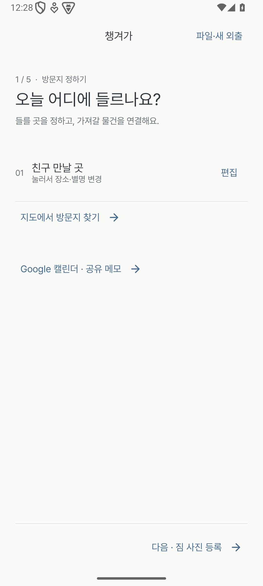
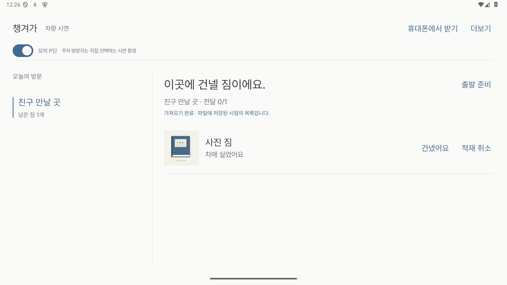

# 챙겨가

챙기려던 물건을 잊지 않도록, 휴대폰에서 준비물을 등록하고 차량에서 적재와 전달을 확인하는 Pleos 차량용 앱입니다.

**현재 버전 0.10.1 release · 업데이트 2026.11.15**

[휴대폰 APK](apk/release/박경태_챙겨가준비_release.apk) · [차량 APK](apk/release/박경태_챙겨가_release.apk) · [차량 화면 시연용 APK](apk/release/박경태_챙겨가시연_release.apk) · [시연 영상](docs/media/changyeoga-demo-0.10.0.mp4)

## 사용 흐름

**방문지 찾기 → 준비물 사진 등록 → 적재 확인 → 차량으로 보내기 → 전달 확인**

| 기능 | 사용 방법 |
|---|---|
| 장소 찾기 | 네이버 지도에서 장소명을 검색하고 위치를 선택합니다. 별명은 선택해서 붙입니다. |
| 준비물 등록 | 사진을 방문지에 연결하고, 눌러서 크게 확인합니다. |
| 적재·전달 확인 | 차에 넣으면 ‘실었어요’, 건네면 ‘건넸어요’를 눌러 기록합니다. |
| 출발 전 집안 확인 | 가스레인지를 직접 확인한 뒤 확인 시각을 저장합니다. |
| 차량 연결 | 같은 Wi-Fi에서 목록과 사진을 일회 전송하거나 ZIP 파일로 옮깁니다. |
| 공유 메모·일정 | 다른 앱의 글을 공유받아 메모로 저장하고 Google 캘린더 일정 작성 화면으로 보냅니다. |
| 차량 조작 제한 | 실제 차량용 앱은 P단과 주행 중 조작 제한을 확인해 준비물 사진과 버튼을 잠급니다. |

## 실행 화면

폰과 차량 모두 밝은 중성 배경, 얇은 구분선, 채움 없는 블루 글자 버튼을 사용합니다. 차량에서는 왼쪽 방문지를 선택하고 오른쪽 준비물을 확인합니다.

| 휴대폰 | 차량 시연 앱 |
|---|---|
|  |  |

[약 1분 27초 실제 앱 시연](docs/media/changyeoga-demo-0.10.0.mp4) · [디자인 기준](docs/design/DESIGN-SYSTEM.md)

## 설치와 실행

| APK | 실행 환경 |
|---|---|
| [휴대폰](apk/release/박경태_챙겨가준비_release.apk) | Android 휴대폰에서 방문지와 준비물을 등록합니다. |
| [차량](apk/release/박경태_챙겨가_release.apk) | Pleos/Android Automotive의 차량 신호를 읽습니다. P단과 UX 제한이 허용될 때 조작합니다. |
| [차량 화면 시연용](apk/release/박경태_챙겨가시연_release.apk) | 일반 Android에서도 차량 UI를 실행합니다. 모의 P단 스위치로 잠금을 확인합니다. |

제출용 APK는 0.10.1 release 서명 빌드입니다. 기존 debug 앱에서 전환할 때는 ZIP으로 목록을 내보낸 뒤 debug 앱을 삭제하고 release 앱을 설치해 가져옵니다. 이후 같은 release 서명으로 업데이트할 수 있습니다. [설치 안내·SHA-256](apk/README.md) · [소스 빌드와 설정](android/README.md)

## 개발과 시험 환경

| 구분 | 환경 |
|---|---|
| 빌드 | Kotlin 2.0.0, JDK 17, Gradle 8.10.2, AGP 8.8.2, compile/target SDK 35 |
| Pleos 초기 SDK·차량 신호 시험 | Pleos Connect 2.1, Android 14/API 34, x86_64 |
| 최신 휴대폰 UI·회귀 시험 | Android 15/API 35, 1080×2400, density 420 |
| 최신 차량 UI 시연 | Android 15/API 35에서 demo 앱 실행, 1920×1080, density 240 |
| 연결 | Pleos NaviHelper 3.0.5, Android Automotive P단·UX 제한, 네이버 지도 SDK 3.24.0 |

최신 빌드와 단위 테스트, 휴대폰 UI 3개·차량 시연 UI 2개 회귀 검사를 통과했습니다. 영상의 차량 상태는 demo 앱의 모의 입력이며, 목록은 ZIP으로 전달했습니다. [최신 적용 기록](docs/28-c-design-applied.md) · [Pleos 초기 실행 기록](docs/05-first-run.md)

## 다음 개발

매일 필요한 준비물과 미리 등록한 물건을 모아 출발할 때 알려주고, 도착 후 전달할 물건도 자동으로 안내하도록 발전시킵니다. 반복 준비물, 백그라운드 알림, 캘린더 일정 불러오기, 공유받은 텍스트·이미지의 일정 및 준비물 등록을 이어서 개발합니다.

조사 자료와 이전 개발 기록

아래 문서는 작성 당시의 조사·개발 이력입니다. 현재 설치·기능 설명은 이 README와 Android·APK·서버 안내를 기준으로 합니다.

- [현대차·Tesla·중국 업체 공식 기능 비교](docs/11-official-app-feature-map.md)
- [Pleos 앱마켓 조사](docs/12-pleos-app-market.md)
- [SDK·API 조사](docs/08-pleos-apis.md)
- [개발 기록](docs/16-development-log.md)
- [검색 서버](server/README.md)
- [공모전 공식 안내](https://appdevchallenge.auto-hmg.io/guide/submission)

서명과 연락처가 포함된 최종 제출 문서는 이 저장소에 포함하지 않습니다.

