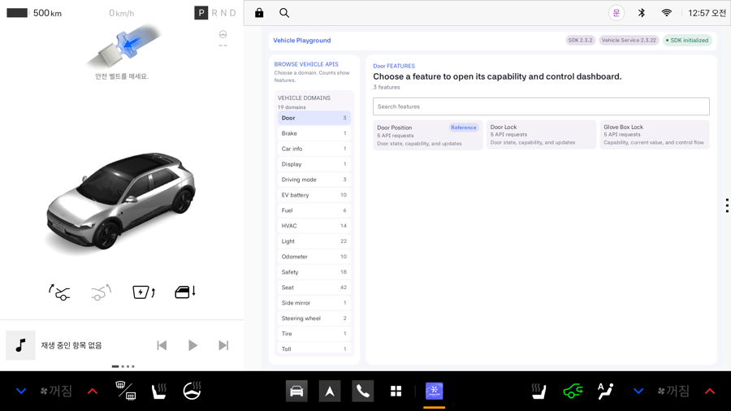

# Pleos 전용 가상 차량에서 첫 앱 실행하기

샘플은 출품할 제품을 고르기 전에 차량용 앱이 실제로 켜지고 다시 실행되는지 시험하는 용도다. 프로젝트 경로와 버전은 재현을 위해 기록한다.

## 이 PC의 구성

| 항목 | 준비한 환경 |
|---|---|
| 개발 도구 | Windows, Android Studio 2026.2.2.8, Microsoft OpenJDK 17, Gradle wrapper 8.10.2 |
| SDK | 사용자 폴더의 `AppData/Local/Android/Sdk`, Android SDK Platform 35와 Build Tools 35.0.0으로 빌드 |
| 가상 차량 | Android 14(API 34), Pleos Connect 2.1, x86_64, RAM 4GB. Windows 가상화 가속 WHPX 사용 가능 확인 |
| 학습 앱 | 공식 Vehicle 샘플 커밋 `959981d`. 해당 소스의 2.3.1은 제조사 Maven에서 찾을 수 없어 실습 사본의 `gradle/libs.versions.toml`에서 `vehicleSdk = "2.3.2"`로 수정해 빌드했다. |

## 11월 2일 실행 결과

샘플 debug APK를 빌드해 PleosContest21 AVD에 설치했다. 강제 종료 후 실행을 두 번 반복해 두 번 모두 MainActivity의 COLD 시작과 전면 표시를 확인했다. 진입 화면에서 SDK 2.3.2와 Vehicle Service 2.3.22가 표시됐고, Door Position에서 운전석 쪽 앞문(ROW_1_LEFT)의 지원 범위 0~1과 현재값 0(닫힘)을 읽었다.



테스트를 마치고 백그라운드 에뮬레이터를 종료했다. 직접 보려면 Android Studio의 Device Manager에서 **Pleos Connect 2.1 Contest**를 시작한 뒤 앱 목록에서 **Vehicle SDK Sample**을 연다. PowerShell에서도 `& "$env:LOCALAPPDATA/Android/Sdk/emulator/emulator.exe" -avd PleosContest21`로 창을 열 수 있다.

## 빌드와 설치

1. 공식 샘플을 이 PC에서는 `%LOCALAPPDATA%\PleosContest\vehicle-sample`에 받았다. Android Studio에서 이 디렉터리를 열고 Gradle JDK를 17로 지정한다. 샘플의 Gradle wrapper를 그대로 사용한다.
2. 새 PC에서 AVD를 구성할 때는 SDK Manager의 SDK Update Sites에 공식 가이드의 Windows 이미지 주소를 추가한다. API 34 Pleos 이미지를 설치하고 Device Manager에서 Automotive 프로필을 선택해 가상 차량을 만든다. 공식 설정은 RAM 4GB와 Cold boot다.
3. 가상 차량이 켜진 상태에서 샘플 디렉터리의 PowerShell에서 다음을 실행한다. SDK 위치와 JDK 17 경로는 실제 설치 위치를 사용한다.

```powershell
$env:ANDROID_HOME = Join-Path $env:LOCALAPPDATA 'Android/Sdk'
$env:JAVA_HOME = (Get-ChildItem 'C:/Program Files/Microsoft' -Directory -Filter 'jdk-17*' | Select-Object -First 1).FullName
Set-Location (Join-Path $env:LOCALAPPDATA 'PleosContest/vehicle-sample')
.\gradlew.bat assembleDebug
.\gradlew.bat installDebug
```

4. 런처에서 **Vehicle SDK Sample**을 연다. 앱이 보이는지 확인하고 종료한 뒤 다시 연다. 다음 실습에서는 Door → Door Position에서 지원 범위를 확인하고 Refresh로 조회 결과를 본다. 화면이 켜졌다는 사실과 차량 신호 조회 성공을 따로 기록한다.
5. 빌드 산출물은 샘플 폴더의 `app/build/outputs/apk/debug/app-debug.apk`다. 개발 도구와 제조사 이미지는 개인 PC에 두며, 공모전 release APK는 주제 선정 후 우리 앱으로 별도 생성한다.

## 원본과 출처

- [공식 Vehicle 샘플 소스와 README](https://github.com/Pleos-Playground/pleos-sample-vehicle-app/tree/959981d)
- [Pleos Connect Emulator 설치 및 실행](https://document.pleos.ai/docs/connect/guide/getting-started/application-development/setup-connect-sdk-emulator)
- [Vehicle SDK Sample App 사용 가이드](https://document.pleos.ai/docs/pleos-only/tutorial/vehicle-sdk-sample-app)
