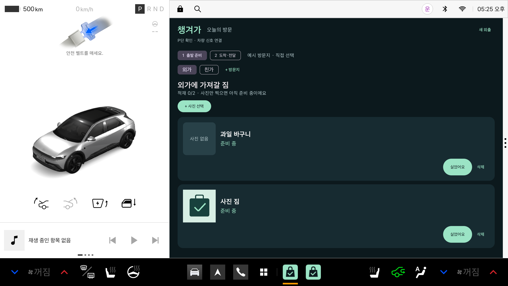
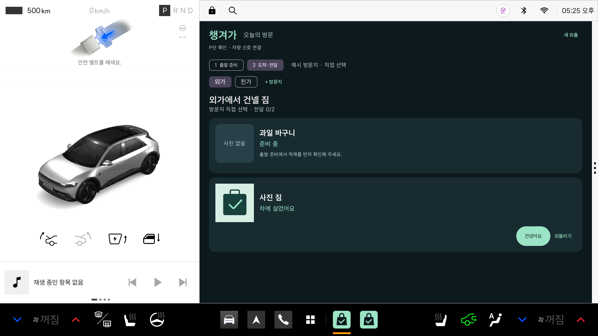

# 챙겨가 개발 기록

## 2026년 11월 6일 첫 실행 버전

숏폼은 앱 완성 후 진행한다. 오늘의 개발 범위는 사진과 방문지, 적재·전달 상태를 저장하는 첫 실행 버전이다. 휴대폰·차량 동기화와 내비 자동 도착은 다음 단계다.

### 구현한 기능

- 방문지 추가와 선택. 이름은 최대 30자이며 빈 값은 저장하지 않는다.
- 사진 선택 후 JPEG 사본을 앱 내부에 저장. 휴대폰용은 외부 카메라 앱의 촬영 미리보기도 지원한다.
- `준비 중 → 차에 실었어요 → 전달 완료` 상태 전환과 되돌리기. 적재 확인을 건너뛴 전달 완료는 허용하지 않는다.
- 선택한 방문지의 짐만 표시. 방문지를 바꾸는 행위는 전달 상태를 바꾸지 않는다.
- JSON을 AtomicFile로 저장. 앱 재실행 시 사진 경로와 방문지·상태 복원.
- 실제 차량용은 AAOS `GEAR_SELECTION`의 P단과 `CarUxRestrictionsManager`의 제한 해제를 함께 확인한다. 서비스 단절·미지원·읽기 실패 시 잠근다. 차량을 제어하는 코드는 없다.
- 별도 패키지의 시연용은 모의 P단 스위치를 제공한다. 실제 차량용에는 해당 스위치가 없다.

### 검증 결과와 범위

환경: Windows, JDK 17, Android SDK 35, PleosContest21 AVD(Android 14 API 34, Pleos Connect 2.1).

| 검증 | 결과 |
|---|---|
| 휴대폰·차량·시연 3개 debug APK 빌드 | 성공 |
| JVM 단위 테스트 6개 | 방문지별 분리, 미적재 전달 거부, 상태 되돌리기, 신호 누락·주행 잠금, 잘못된 방문지 참조, 방문지 이름 검사 통과 |
| Pleos AVD 시연용 계측 테스트 3개 | 적재·전달·재실행·되돌리기 흐름, 모의 주행 시 사진/버튼 숨김, 사진·목록 저장/복원 통과 |
| 실제 차량용 P단 및 UX 제한 읽기 | AVD에서 `P단 확인 · 차량 신호 연결` 표시 확인 |
| Android 사진 선택기 | AVD의 사진함에 만든 시험 JPEG를 선택해 사진 항목과 내부 파일 저장 확인 |
| 강제 종료 및 가상 차량 재부팅 | 사진과 방문지 복원, 실제 차량용에서 적재·전달 조작 확인 |
| 주행 중 실제 VHAL 신호 변화 | 미검증. AVD의 car_service 셸 명령이 user 빌드에서 제한됨. 모의 주행 테스트와 실제 P단 읽기 결과를 구분한다. |
| 실제 휴대폰 카메라·양산차 | 미검증 |

시험 사진은 개발자가 만든 기하학 도형 이미지이며 사용자의 실제 짐 사진이나 이용자 실험 자료가 아니다. 자동 테스트는 기능 검증이며 누락 감소 효과의 사용자 검증을 뜻하지 않는다.

### 해결한 개발 환경 문제

Windows 한글 작업 경로에서 Android Gradle Plugin의 경로 검사가 빌드를 막았다. `android.overridePathCheck=true`를 적용한 뒤 앱 빌드는 성공했지만 테스트 JVM은 한글 클래스 경로를 읽지 못했다. 소스는 그대로 두고 `-PbuildRoot=<영문 경로>`로 생성물만 옮겨 6개 테스트를 실행했다. `android/build.ps1`은 이 설정을 제공한다.

사진 선택기는 별도 화면이므로 돌아올 때 차량 서비스가 다시 연결될 수 있다. 선택 결과는 저장하되, 화면 조작은 차량 상태가 확인될 때까지 잠그도록 처리했다.

반복 계측 실행 중 초기화 대화상자에서 실행이 지연된 회차가 있었다. 해당 테스트 프로세스를 종료하고 AVD의 창·전환·애니메이터 애니메이션을 끈 상태에서 재실행해 최종 3개 테스트가 통과했다. 이후 설정은 원래 값으로 복원했다. 이 현상의 원인이 앱인지 AVD의 다중 창 동기화인지 확정하지 않았으며 후속 재실행 검증에서 관찰한다.

후속 수동 확인에서도 앱 표시 영역이 갱신되지 않는 현상을 관찰했다. AVD를 `-gpu swiftshader_indirect -no-snapshot-load -no-snapshot-save`로 다시 시작하고 부팅 후 기본 내비가 열린 다음 앱을 전면으로 가져오자 정상 표시·버튼 반응·저장 복원을 확인했다. 실제 기기에서 발생하는 현상으로 단정하지 않는다.

### 실제 실행 화면

아래는 목업이 아닌 Pleos AVD의 실제 화면이다. 방문지는 직접 선택하며, 가방 그림은 사진 가져오기 검증용 JPEG다.

### 다음 개발 순서

1. 휴대폰에서 등록한 방문지·사진을 차량에 전달하는 연결 구현. 현재 기기별 목록은 독립적이다.
2. NaviHelper에 목적지·경유지를 대응시키고 실제 도착 이벤트 수신 시험. 현재는 방문지 직접 선택이다.
3. 출발 전 예약 알림과 외출 전 점검 사진 분류.
4. 실제 휴대폰 촬영·차량 화면 사용성 검증, 사용자 2명 과제 비교, release APK 준비.

## 실행법과 원본 및 출처

- [Android 소스 및 실행법](../android/README.md)
- [기획서 초안](15-proposal-draft.md)
- [Pleos 주행 제한 가이드](https://document.pleos.ai/en/docs/pleos-only/vehicle-app-developer-guide/driving-restriction-development-guide)
- [Google GEAR_SELECTION 문서](https://developer.android.com/reference/android/car/VehiclePropertyIds#GEAR_SELECTION)
- [주행 제한 API](https://developer.android.com/reference/android/car/drivingstate/CarUxRestrictionsManager)
- [상태 로직 테스트 원본](../android/app/src/test/java/io/changyeoga/app/TripTest.kt)
- [에뮬레이터 계측 테스트 원본](../android/app/src/androidTest/java/io/changyeoga/app/TripFlowTest.kt)
